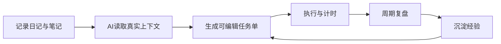
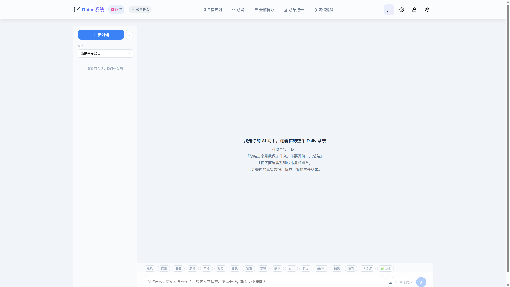
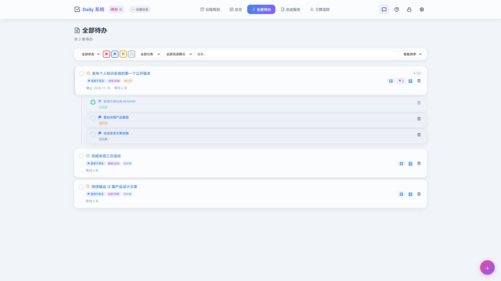
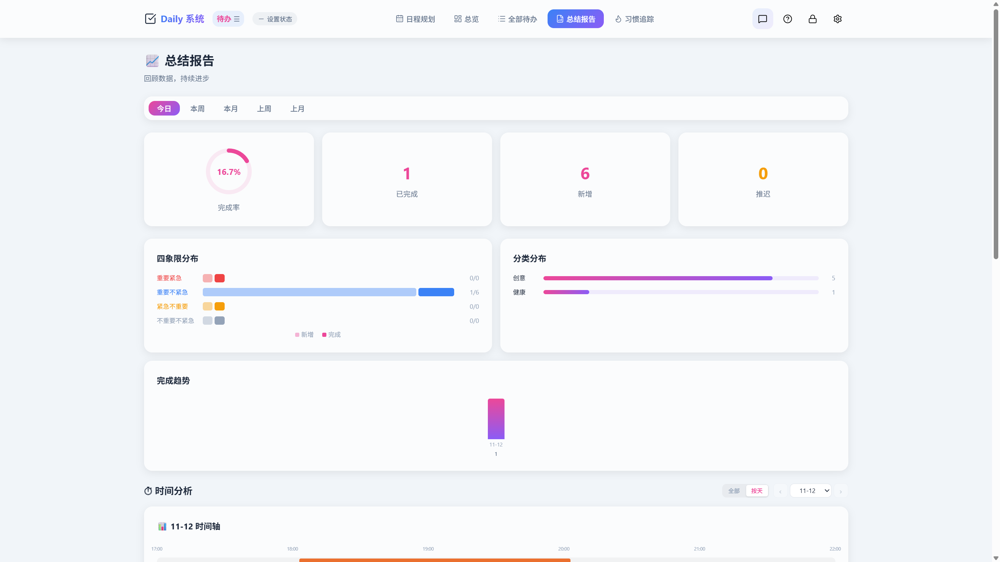
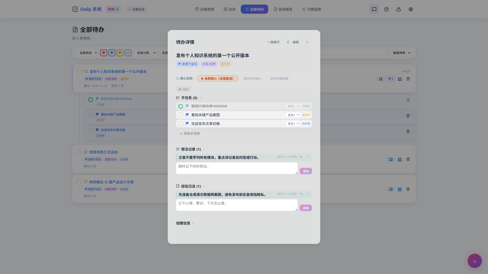

# Daily

自托管的 AI 个人行动与反思系统。

Daily 把待办、日记、笔记、目标和个人复盘放在同一个上下文里：AI 先读取真实记录，再回答问题；把零散想法整理成可编辑任务单；在执行后沉淀经验，并在下一次行动前重新找回来。

> 项目当前面向单用户自托管场景，不是多租户 SaaS，也不提供医疗或心理咨询服务。

## 为什么做 Daily

很多工具能保存信息，但记录、行动和复盘通常彼此割裂：

- 日记写完后很少回看；
- AI 不知道你真实做过什么，容易给出空泛建议；
- 灵感变成任务时缺少结构；
- 复盘得到的教训，下次执行前又找不到。

Daily 想建立一条完整闭环：



## 产品一览









## 核心能力

### 1. 统一助手，而不只是聊天框

助手可以读取待办、日记、笔记、心力记录和目标。日报、周报、月报先查询对应周期的真实数据，再组织答案。写操作默认经过确认，避免 AI 擅自改动个人系统。

### 2. 从自然语言到可编辑任务单

把一段零散计划交给 `/任务单`，AI 会拆成父子任务草稿，补充象限和紧急度。你可以修改、增删、调整层级，确认后才写入数据库。

### 3. 周、月、年度目标对齐

核心目标不是另一套清单，而是现有任务的周期性聚焦。系统会结合计划、完成时间、计时和记录，检查实际投入是否对齐最重要的目标。

### 4. 从反思回到行动

可以从一篇日记或笔记进入教练对话。教练一次只问一件事，结束时沉淀承诺和跟进项；经确认后转成待办，完成任务时再闭环跟进状态。

### 5. 经验附着在真实任务上

每条待办都可以分别记录“想法”和“经验沉淀”。助手能在下一次相似任务前查询历史教训，而不是让经验散落在另一份笔记里。

## 技术栈

- 前端：Vue 3、TypeScript、Vite、Pinia、SCSS
- 后端：FastAPI、SQLAlchemy、aiosqlite
- 数据库：SQLite
- AI：兼容 OpenAI 风格接口，模型配置保存在本地数据库
- 部署：Docker Compose，或前后端分别运行

## 快速开始

### Docker Compose

要求：Docker 24+ 与 Docker Compose v2。

```bash
git clone https://github.com/08163356/daiy-workshop.git
cd daiy-workshop
cp .env.example .env
```

编辑 `.env`，至少修改：

```env
INITIAL_ADMIN_PASSWORD=use-a-long-random-password
```

启动：

```bash
docker compose up -d --build
```

访问 `http://localhost:8080`。首次登录后，在“系统设置”中添加自己的 AI 模型配置。

写入虚构演示数据：

```bash
docker compose exec backend python scripts/seed_demo.py
```

### 本地开发

后端：

```bash
cd backend
python -m venv .venv
# Windows: .venv\Scripts\activate
# macOS/Linux: source .venv/bin/activate
pip install -r requirements.txt
set INITIAL_ADMIN_PASSWORD=change-me-now
uvicorn app.main:app --reload --port 8088
```

前端：

```bash
cd frontend
npm ci
npm run dev
```

前端默认访问 `http://localhost:8088` 的 API。

## 数据与隐私

- 所有业务数据默认保存在本地 SQLite 数据库。
- AI 分析会把当前任务需要的文本发送给你配置的模型服务商。
- `.env`、数据库、日志、上传文件和 `user-data/` 默认不会进入 Git。
- 公开 Demo 应使用 `scripts/seed_demo.py` 生成的虚构数据，不要复制个人数据库。
- 当前认证适合受信网络中的单用户部署；公网部署请同时启用 HTTPS、防火墙和反向代理访问控制。

详见 [安全说明](SECURITY.md) 与 [隐私边界](docs/privacy.md)。

## 项目结构

```text
.
├── backend/              FastAPI、领域模型、Agent 工具与测试
├── frontend/             Vue 3 Web 应用
├── docs/                 设计说明、发布文章与截图
├── docker-compose.yml
└── .env.example
```

## 设计文档

- [为什么周期总结必须读取真实数据](docs/design/period-bundle.md)
- [为什么 AI 写入前必须经过确认](docs/design/confirmation-gate.md)
- [从日记到行动的教练闭环](docs/design/coaching-loop.md)
- [发布文章：我为什么为自己做了一个 Daily](docs/articles/launch-zh.md)

## 开发与贡献

提交 Issue 前请先搜索是否已有相同问题。代码贡献流程见 [CONTRIBUTING.md](CONTRIBUTING.md)。

## License

Daily 使用 [GNU Affero General Public License v3.0](LICENSE)。如果你修改并通过网络向用户提供该程序，也需要向这些用户提供对应源代码。
