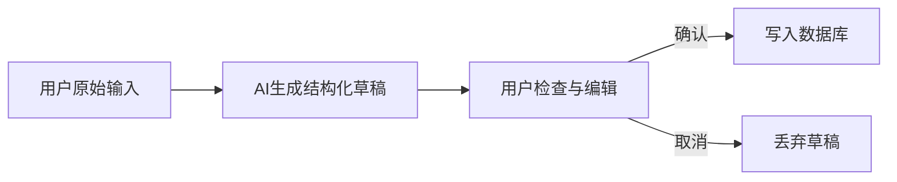

# 为什么 AI 写入前必须经过确认

个人系统中的错误写入比错误回答更难察觉：一条被误创建、误完成或误排期的任务，会继续污染日历、周报和用户画像。

Daily 将工具分成只读与写入两类：

- 查询、检索和周期取数可以直接执行；
- 创建任务、保存记录、写入排期和沉淀经验必须展示确认卡；
- `/任务单` 先生成可编辑草稿，用户可修改标题、象限、紧急度和父子关系；
- 用户确认后才真正提交数据库；
- 取消、断流或工具异常时默认不写入。

确认门不是多余步骤，而是把 AI 的角色限定为“提出可检查的建议”，并让最终控制权留在用户手中。
