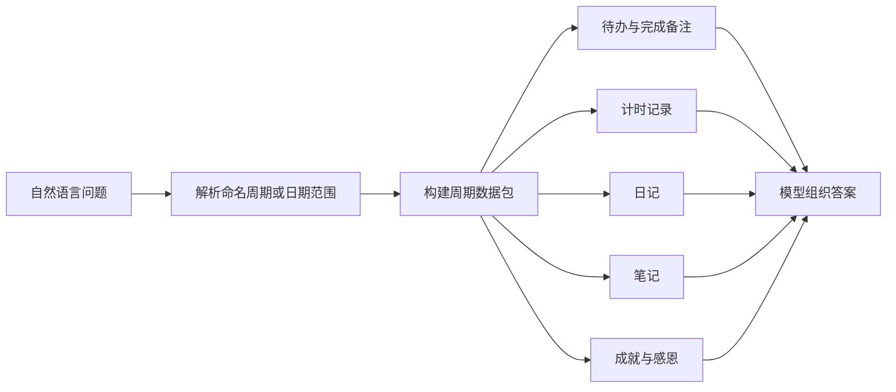

# 为什么周期总结必须读取真实数据

“总结我上个月做了什么”看起来像普通问答，实际上是一项数据任务。

如果只把问题交给模型，它可能不调用工具，或只读取未完成待办；如果只按计划日期查询，又会把计划过但没做的事当成成果。Daily 因此把周期解析和取数放在服务端确定性执行。

## 数据流

## 三个原则

1. **先取数，再表达**：命中总结意图后服务端先构建 `get_period_bundle`，不依赖模型临场决定是否调用工具。
2. **发生事实优先于计划**：综合计划日期、完成时间、计时、补充记录与父子任务关系。
3. **没有记录就明确说不知道**：可信度比“看起来完整”更重要。

这种设计让模型负责归纳与表达，把日期边界、查询范围和事实来源留给可测试的程序逻辑。
